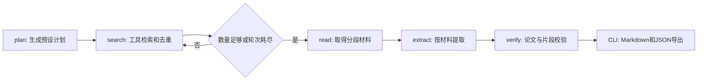

# 架构与接口

## 当前可运行流程

当前DemoModel是确定性函数，DemoLiterature是合成材料；以上是编排基础，不是自主科研Agent。M3将在读取后增加缺口分析、综合比较及受预算控制的补检索分支。

## 契约

正式定义位于`src/litresearch/models.py`、`ports.py`。

| 接口 | 输入 | 输出 | 实现负责人 |
|---|---|---|---|
| ModelPort.plan | ResearchRequest | SearchPlan（1—3个非空查询） | 成员一 |
| ModelPort.extract | PaperRecord、Document | Finding列表 | 成员一 |
| LiteraturePort.search | 查询字符串、数量上限 | PaperRecord列表 | 成员二 |
| LiteraturePort.read | PaperRecord | 同一paper_id的Document | 成员二 |
| run_research | 请求及两个端口、明确mode | ResearchReport | 成员一 |
| render_markdown | ResearchReport | Markdown字符串 | 成员三 |

M0为同步端口。接入网络时为请求设置明确超时；若改为异步，在独立变更中同步迁移图和测试，不在同步端口内无界等待。

PaperRecord包含来源、DOI及材料层级；Document按block_id组织文本，page为可选物理页码。合成材料与摘要没有PDF页码时保留空值。Finding保存维度、结论、原文片段及定位；ModelPort返回其他论文ID的结果会被排除。

## 错误策略

- 检索TimeoutError/ConnectionError消耗本轮，记录异常并在剩余预算内尝试下一查询。
- 阅读OSError/ValueError记录失败，其他论文继续；空文档记录无文本。
- 模型错误与未预料程序错误目前向调用方抛出，不能伪装成功；M1补充可分类错误及有限重试。
- 超过论文预算的返回结果截断；检索不足仍生成有限结果与说明。
- 证据位置不存在或片段不在原文中，移出结果并保留原因。

## 持久化与可观测性边界

M0只有内存状态及最终JSON事件列表；没有SQLite、后台作业或中断恢复。M4分别实现任务表、事件表、产物表，并测试节点中断后的行为。框架支持持久化不等于当前项目已经提供恢复能力。

公开仓库不存真实运行数据。实际论文、模型原始返回、密钥及数据库保存在忽略目录，分享结果前另行审查。
